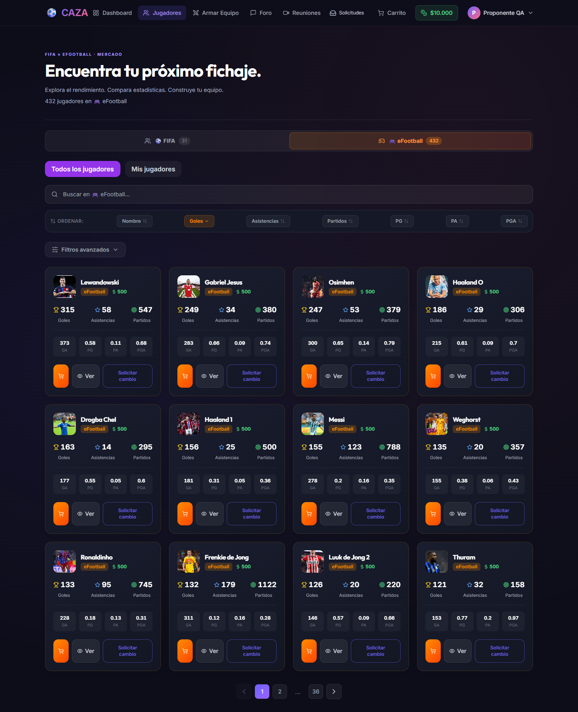
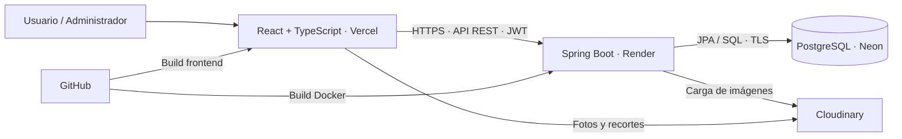
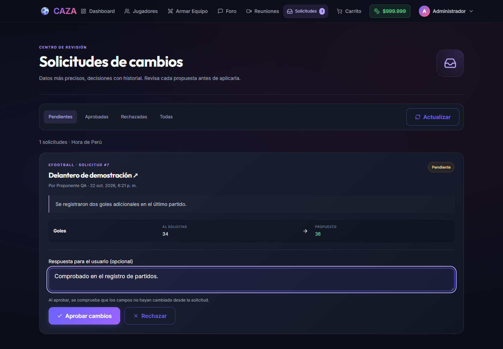
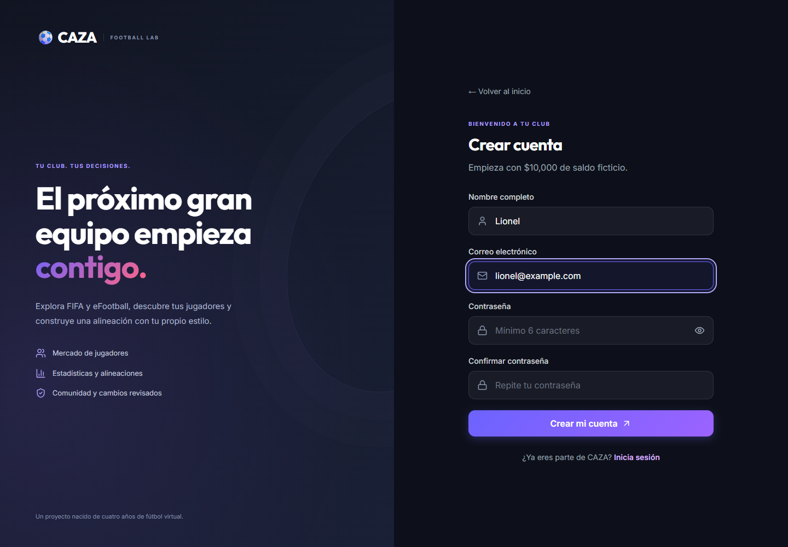
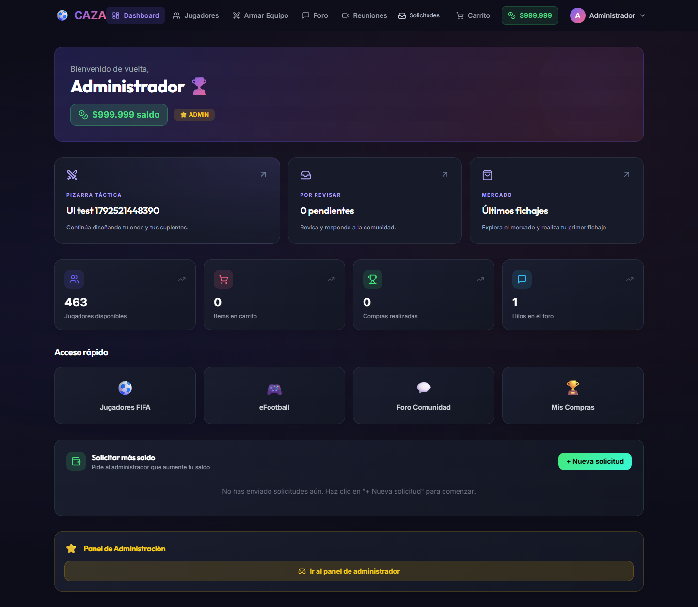

# ⚽ CAZA – Plataforma de Simulación & Mercado de Fútbol 🎮

Bienvenido a **CAZA**, la plataforma digital interactiva diseñada por y para apasionados del fútbol y de los videojuegos **FIFA** y **eFootball**.

[🌐 Abrir CAZA](https://caza-fifa.vercel.app)

Aplicación full stack desplegada en **Vercel** (frontend), **Render** (backend) y **Neon** (PostgreSQL), con imágenes alojadas en **Cloudinary**.



---

## 🎬 Demostración en Video (Video Demo)

Puedes ver el recorrido demostrativo completo en video sobre el funcionamiento de la plataforma **CAZA** en el siguiente enlace:

<div align="center">
  <br>
  <a href="https://drive.google.com/file/d/15zWswcHvnSt8cehlb1d3gmsLqjsgFul1/view?usp=sharing" target="_blank">
    
  </a>
  <br><br>
  <p><i><b><a href="https://drive.google.com/file/d/15zWswcHvnSt8cehlb1d3gmsLqjsgFul1/view?usp=sharing" target="_blank">▶️ Haz clic aquí para ver o reproducir la demostración en video en Google Drive</a></b></i></p>
  <br>
</div>

---

## 🌟 ¿Qué es CAZA?

**CAZA** convierte al usuario en el **Presidente, Director Deportivo y Entrenador de su propio club**, permitiéndole explorar futbolistas, analizar métricas de rendimiento, realizar fichajes en un mercado interactivo y diseñar alineaciones tácticas profesionales.

---

## 💎 El Gran Valor Añadido: Una Base de Datos Creada desde la Experiencia Real

A diferencia de cualquier otra plataforma con datos genéricos o aleatorios, la base de datos de **CAZA** posee un valor único e incomparable: **es el fruto de mis 4 años de trayectoria y seguimiento estadístico real dentro del juego, es decir, son los datos que recopilé en todo este tiempo que he llevado jugando estos videojuegos**.

Cada uno de los más de 400 futbolistas presentes en la plataforma y todas sus métricas (goles, asistencias, partidos y promedios) provienen de mi registro histórico obtenido a lo largo de 4 años de juego.

* ⚽ **En FIFA:** Datos recopilados a través de múltiples temporadas en el *Modo Carrera como Director Técnico (DT)*.
* 🎮 **En eFootball:** Estadísticas de rendimiento compitiendo en el exigente modo de *Divisiones*.

De esta forma, **CAZA** no solo presenta números: refleja la verdadera eficacia, rendimiento y comportamiento de cada jugador en la cancha virtual bajo mi dirección a lo largo de los años.

---

## 🕹️ Guía de Uso e Interacción con la Aplicación

### 🔑 1. Registro e Inicio de Sesión
* **Crear Cuenta:** Cuando el registro está habilitado, haz clic en **"Registrarse"**, ingresa tu nombre, correo electrónico y contraseña. Al registrarte recibirás automáticamente un **saldo inicial de $10,000** para tus contrataciones.
* **Iniciar Sesión:** Ingresa tu correo y contraseña registrados para acceder a tu panel de usuario.
* **Acceso de Administrador:** En el pie de página o visitando `/admin/login`, puedes acceder como Administrador.

---

### 🔍 2. Exploración y Filtro de Jugadores (Sección Jugadores)
* **Navega por pestañas:** Cambia fácilmente entre el catálogo de **⚽ FIFA** y **🎮 eFootball**.
* **Buscador:** Escribe el nombre de cualquier jugador en la barra superior para ubicarlo de inmediato.
* **Filtros por Ordenamiento:** Haz clic en las etiquetas de la parte superior para ordenar de menor a mayor (o viceversa) por **Nombre, Goles Totales, Asistencias Totales, Edad, Precio o Nacionalidad** (en FIFA) o por **Goles, Asistencias, Partidos, PG, PA y PGA** (en eFootball).
* **Filtros Avanzados (eFootball):** Activa el panel de *"Filtros Avanzados"* para ingresar rangos numéricos exactos (ej. Jugadores con más de 100 goles o PG > 0.5). El sistema filtrará la lista y ajustará las páginas mostrando **únicamente** a los futbolistas que cumplan todos los requisitos.

---

* **Continuidad de navegación:** El catálogo comienza ordenado por goles de mayor a menor y conserva la página y los filtros al regresar de una ficha.
* **Mis jugadores:** Consulta un catálogo con los futbolistas comprados, incluidos los que uses como titulares o suplentes.

### 📝 3. Ficha y Edición de Jugadores
* **Ver Estadísticas:** Haz clic en el botón **"Ver"** de cualquier tarjeta de jugador para ver su desglose de temporadas, fotos y métricas de rendimiento. Las fichas de FIFA y eFootball incorporan un efecto holográfico 2D y barras interactivas de goles, asistencias y partidos.
* **Actualizar Fotos / Estadísticas:** Solo el Administrador puede editar directamente nombres, fotos, precios y estadísticas. Los usuarios pueden enviar propuestas de corrección para su revisión.

---

### 🛒 4. Mercado de Fichajes y Gestión de Saldo
* **Añadir al Carrito:** Haz clic en **"Carrito"** en cualquier jugador disponible para sumarlo a tu lista de transferencias.
* **Comprar / Checkout:** Ve a la pestaña **Carrito**, revisa el monto total y confirma la transferencia si cuentas con saldo suficiente.
* **Solicitar Saldo:** Si tu saldo se agota, ve a tu perfil / dashboard y presiona **"Solicitar Saldo"**. El administrador revisará tu petición desde el panel de control `/admin` y podrá aprobarla o rechazarla.
* **Mis Compras:** En esta sección podrás ver todo tu historial de contrataciones.

---

### ⚔️ 5. Armar Equipo (Laboratorio Táctico)
* **Pizarra Táctica:** Entra a la sección **"Armar Equipo"** para visualizar un campo visual con posiciones y distribución táctica.
* **Elegir Formación:** Selecciona entre distintas estrategias tácticas (4-3-3, 4-4-2, 4-2-3-1, 3-5-2, 5-4-1, 4-3-2-1, 5-2-3, 4-1-4-1, 4-2-4, 4-5-1, etc.).
* **Asignar Jugadores:** Haz clic sobre cualquier casilla `(+)` en el campo para buscar y posicionar al jugador ideal en cada demarcación.
* **Modos de Juego:**
  * **Mi Equipo:** Utiliza solo los futbolistas que has fichado previamente en el Mercado.
  * **Equipo Potencial:** Prueba alineaciones de ensueño usando a cualquier futbolista disponible en la plataforma.
* **Equipos guardados:** Asigna un nombre a tu plantilla para cargarla posteriormente. El autoguardado y la sincronización permiten continuar desde otro dispositivo.
* **Titulares y suplentes:** Organiza el once inicial y el banquillo mediante arrastrar y soltar o selección por toque.
* **Importar y exportar:** Conserva y recupera tus alineaciones mediante archivos.

---

### 📬 6. Solicitudes de Cambios y Administración

* **Proponer una corrección:** El usuario indica los valores que desea modificar y el motivo. El catálogo permanece intacto mientras la propuesta está pendiente.
* **Revisar solicitudes:** El Administrador compara los valores actuales y propuestos, y aprueba o rechaza la solicitud. Cada usuario puede consultar el estado de sus propias propuestas.
* **Archivo recuperable:** Los jugadores pueden archivarse y restaurarse desde la administración.
* **Auditoría y reportes:** El Administrador consulta el historial de cambios y descarga reportes PDF con los filtros seleccionados.

### 💬 7. Comunidad

Foro con publicaciones y comentarios, además de gestión de reuniones para organizar la actividad de la comunidad.

---

## Stack y responsabilidades

| Capa | Tecnologías | Aplicación en el proyecto |
|---|---|---|
| Frontend | React 18, **TypeScript**, Vite, Tailwind CSS | Componentes, formularios, navegación, gráficos y diseño adaptable |
| Backend | **Java 21**, Spring Boot 3.2, Maven | API REST, validación y reglas del negocio |
| Seguridad | Spring Security, JWT, BCrypt | Sesiones por token, hash de contraseñas y autorización por rol |
| Persistencia | PostgreSQL, Spring Data JPA / Hibernate | Relaciones, consultas paginadas, transacciones y columnas calculadas |
| Base en la nube | **Neon** | PostgreSQL del entorno desplegado |
| Backend en la nube | **Render**, Docker | Construcción del JAR y ejecución del servicio |
| Frontend en la nube | **Vercel** | Construcción y publicación del frontend |
| Imágenes | Cloudinary | Almacenamiento externo de fotos y recortes |
| Reportes | jsPDF | PDF descargable de la auditoría filtrada |
| Flujo de trabajo | Git, GitHub, GitHub Actions | Historial, ramas y comprobación automática del código |

## Arquitectura



Las credenciales de PostgreSQL y Cloudinary permanecen en el backend. Vercel recibe la URL pública de la API; no necesita contraseñas de la base.

## Decisiones de ingeniería

| Problema | Solución implementada |
|---|---|
| Jugadores repetidos en páginas consecutivas por empates | Orden secundario por ID en las consultas, incluidos agregados FIFA |
| Perder la página al regresar de una ficha | Estado del catálogo conservado por usuario en la sesión del navegador |
| Repetir una compra al reintentar | Clave de idempotencia y serialización de operaciones de compra por usuario |
| Editar una alineación desde dos dispositivos | Versionado y aviso de conflicto antes de sobrescribir |
| Cambios de estadísticas sin revisión | Propuesta persistente y aprobación transaccional exclusiva del administrador |
| Aprobar una propuesta desactualizada | Comparación con los valores originales de los campos solicitados y respuesta 409 ante conflicto |
| Dos aprobaciones simultáneas | Bloqueo de la solicitud durante la resolución; solo una puede aplicarse |
| Necesidad de conocer quién cambió un dato | Auditoría en la transacción, con solicitante y administrador identificables en las solicitudes |
| Fotos perdidas al reiniciar el servidor | Almacenamiento en Cloudinary en lugar del disco temporal del backend |

## Roles y solicitudes

| Operación | Usuario | Administrador |
|---|:---:|:---:|
| Ver jugadores, comprar y guardar equipos propios | ✓ | ✓ |
| Enviar una propuesta de corrección | ✓ | ✓ mediante API; edición directa disponible |
| Consultar solicitudes | Solo propias | Todas |
| Crear, editar y archivar jugadores | — | ✓ |
| Aprobar / rechazar cambios | — | ✓ |
| Exportar auditoría | — | ✓ |

Las restricciones se aplican en el servidor, además de adaptar los botones visibles. Las estadísticas derivadas de eFootball se recalculan en PostgreSQL. Las solicitudes FIFA identifican la temporada afectada; no crean temporadas nuevas.



<details>
<summary>Más capturas de la interfaz</summary>




Las capturas se tomaron en un entorno local de pruebas. Los ejemplos de solicitudes son datos de demostración.
</details>

## Estructura

```text
caza-backend/     API Spring Boot, seguridad, modelos y pruebas Java
caza-frontend/    Aplicación React / TypeScript
scripts/         Comprobaciones de integración y utilidades de migración
docs/            Guías, migraciones SQL y capturas
.github/         Comprobaciones automáticas de compilación y pruebas
```

## 💻 Guía de Instalación y Ejecución Local

### 📋 Requisitos Previos

- **Node.js 20** y npm.
- **Java JDK 21** y **Maven** instalado.
- **PostgreSQL 16** con el esquema de CAZA y las migraciones correspondientes.

El repositorio no incluye los datos privados de producción ni un Maven Wrapper. Esta versión requiere una base previamente preparada: Hibernate valida el esquema; no crea las tablas ni una cuenta de administrador automáticamente. La preparación de la base y las variables de entorno se documentan en [la documentación técnica](docs/MIGRACION.md).

### 1️⃣ Ejecutar el Backend (Spring Boot)

Configura las variables de conexión a PostgreSQL, JWT y CORS tomando como referencia `caza-backend/.env.example`. Spring Boot recibe estas variables del entorno; no carga ese archivo automáticamente.

Desde la raíz del repositorio:

```bash
cd caza-backend
mvn clean verify
mvn spring-boot:run
```

La API local utiliza `http://localhost:8080`. El registro de usuarios se controla mediante `REGISTRATION_ENABLED`; las nuevas cuentas reciben el rol de usuario.

### 2️⃣ Ejecutar el Frontend (React + Vite)

Crea `caza-frontend/.env.local` con la dirección de la API local:

```dotenv
VITE_API_BASE_URL=http://localhost:8080/api
```

En otra terminal, desde la raíz del repositorio:

```bash
cd caza-frontend
npm ci
npm run dev
```

Abre la dirección que indique Vite, normalmente `http://localhost:5173`.

## 🧪 Calidad y Verificación

- **Backend:** compilación y pruebas Java con `mvn clean verify`.
- **Frontend:** compilación TypeScript y construcción con `npm run build`.
- **Integración:** comprobaciones de paginación, permisos, validación, aprobación concurrente, rechazo de solicitudes, conflictos y auditoría en un entorno local aislado.
- **Integración continua:** workflow de GitHub Actions para compilar el frontend y ejecutar las pruebas Java en pushes y pull requests.

Los resultados y el alcance de las comprobaciones se recogen en [validación de la experiencia](docs/VALIDACION_EXPERIENCIA.md) y [validación de solicitudes](docs/VALIDACION_SOLICITUDES.md).

---

## 🏆 Conclusión

> *"CAZA es la síntesis perfecta entre el análisis de datos futbolísticos y mi pasión del gaming. Al alimentar la plataforma con 4 años de datos reales cosechados en el Modo Carrera de FIFA y las Divisiones de eFootball, el proyecto ofrece una herramienta inmersiva, auténtica y con un valor sentimental y técnico incomparable para cualquier apasionado de la simulación futbolística, especialmente para mí."*
