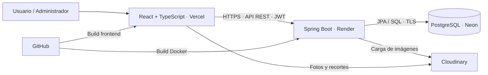

# CAZA · Football Lab

**Catálogo, mercado virtual y gestión de equipos para FIFA y eFootball.**

Proyecto full stack desarrollado a partir de mis registros personales de cuatro años de partidas: estadísticas del Modo Carrera de FIFA y de las Divisiones de eFootball. CAZA convierte esos datos en una aplicación para explorar rendimiento, realizar fichajes con saldo ficticio y diseñar alineaciones.

[Aplicación desplegada](https://caza-fifa.vercel.app) · [Guía de despliegue](docs/MIGRACION.md) · [Última actualización](docs/GUIA_SOLICITUDES_Y_PUBLICACION.md)

> La infraestructura ya está desplegada en Vercel, Render y Neon. Las novedades de esta revisión se verán en la demo después de aplicar la migración y publicar el código. El registro puede estar cerrado por configuración. El backend puede tardar en responder tras un periodo de inactividad.


## Qué permite hacer

- **Explorar dos catálogos:** búsqueda, filtros, orden por goles y paginación estable con desempate por ID.
- **Analizar jugadores:** estadísticas por temporada en FIFA, métricas de rendimiento de eFootball y barras interactivas.
- **Consultar fichas visuales:** efecto holográfico 2D, imagen original y recorte transparente opcional; no utiliza modelos 3D.
- **Comprar con saldo ficticio:** carrito con cantidades, subtotales, historial y protección frente a reintentos del checkout.
- **Consultar mis jugadores:** catálogo personal de compras, sin repetir una tarjeta por cada compra del mismo futbolista.
- **Diseñar equipos:** formaciones, titulares, suplentes, arrastrar y soltar o selección por toque, autoguardado y sincronización entre dispositivos.
- **Proponer correcciones:** un usuario solicita cambios; un administrador los aprueba o rechaza. La propuesta no altera el catálogo mientras está pendiente.
- **Administrar con trazabilidad:** edición exclusiva del administrador, archivo recuperable de jugadores, historial de cambios y exportación a PDF.
- **Participar:** foro, comentarios, reuniones y solicitudes de saldo.

Las estadísticas proceden de partidas personales, no de una fuente oficial de rendimiento del fútbol profesional. El saldo y las compras son simulados; no hay cobros reales.

## Stack y responsabilidades

| Capa | Tecnologías | Aplicación en el proyecto |
|---|---|---|
| Frontend | React 18, **TypeScript**, Vite, Tailwind CSS | Componentes, formularios, navegación, gráficos y diseño adaptable |
| Backend | **Java 21**, Spring Boot 3.2, Maven | API REST, validación y reglas del negocio |
| Seguridad | Spring Security, JWT, BCrypt | Sesiones por token, contraseñas cifradas mediante hash y autorización por rol |
| Persistencia | PostgreSQL, Spring Data JPA / Hibernate | Relaciones, consultas paginadas, transacciones y columnas calculadas |
| Base en la nube | **Neon** | PostgreSQL del entorno desplegado |
| Backend en la nube | **Render**, Docker | Construcción del JAR y ejecución del servicio |
| Frontend en la nube | **Vercel** | Construcción y publicación del frontend |
| Imágenes | Cloudinary | Almacenamiento externo de fotos y recortes |
| Reportes | jsPDF | PDF descargable de la auditoría filtrada |
| Flujo de trabajo | Git, GitHub, GitHub Actions | Historial, ramas y comprobación automática del código |

El frontend utiliza TypeScript, que se compila a JavaScript. Java se utiliza en el backend: son lenguajes distintos con responsabilidades diferentes.

## Arquitectura



Las credenciales de PostgreSQL y Cloudinary permanecen en el backend. Vercel recibe la URL pública de la API; no necesita contraseñas de la base.

## Decisiones de ingeniería

| Problema | Solución implementada |
|---|---|
| Jugadores repetidos en páginas consecutivas por empates | Orden secundario por ID en las consultas, incluidos agregados FIFA |
| Perder la página al regresar de una ficha | Estado del catálogo conservado por usuario en la sesión del navegador |
| Repetir una compra al reintentar | Clave de idempotencia y serialización de operaciones de compra por usuario |
| Editar una alineación desde dos dispositivos | Versionado y aviso de conflicto antes de sobrescribir |
| Cambios de estadísticas sin revisión | Propuesta persistente y aprobación transaccional exclusiva del administrador |
| Aprobar una propuesta desactualizada | Comparación con los valores originales de los campos solicitados y respuesta 409 ante conflicto |
| Dos aprobaciones simultáneas | Bloqueo de la solicitud durante la resolución; solo una puede aplicarse |
| Necesidad de conocer quién cambió un dato | Auditoría en la transacción, con solicitante y administrador identificables en las solicitudes |
| Fotos perdidas al reiniciar el servidor | Almacenamiento en Cloudinary en lugar del disco temporal del backend |

## Roles y solicitudes

| Operación | Usuario | Administrador |
|---|:---:|:---:|
| Ver jugadores, comprar y guardar equipos propios | ✓ | ✓ |
| Enviar una propuesta de corrección | ✓ | ✓ mediante API; edición directa disponible |
| Consultar solicitudes | Solo propias | Todas |
| Crear, editar y archivar jugadores | — | ✓ |
| Aprobar / rechazar cambios | — | ✓ |
| Exportar auditoría | — | ✓ |

Las restricciones se aplican en el servidor, además de adaptar los botones visibles. Las estadísticas derivadas de eFootball se recalculan en PostgreSQL. Las solicitudes FIFA identifican la temporada afectada; no crean temporadas nuevas.


<details>
<summary>Más capturas de la interfaz</summary>


Las capturas se tomaron en un entorno local de pruebas. Los ejemplos de solicitudes son datos de demostración.
</details>

## Estructura

```text
caza-backend/     API Spring Boot, seguridad, modelos y pruebas Java
caza-frontend/    Aplicación React / TypeScript
scripts/         Comprobaciones de integración y utilidades de migración
docs/            Guías, migraciones SQL y capturas
.github/         Comprobaciones automáticas de compilación y pruebas
```

## Ejecutar en local

Requisitos: Java 21, Maven, Node.js 20 y PostgreSQL 16 compatible con el esquema. El repositorio no incluye un Maven Wrapper ni datos personales de producción.

**Esta versión requiere una base con el esquema existente restaurado.** Los SQL de `docs/migrations` son incrementales: no crean por sí solos toda la base desde cero. Hibernate valida el esquema y no ejecuta seeds ni crea automáticamente un administrador. Consulta [la guía de preparación](docs/MIGRACION.md) para restaurar una copia local. No conectes las pruebas a Neon.

1. Configura las variables de conexión, JWT y CORS en tu entorno local; usa `caza-backend/.env.example` como referencia. Un archivo `.env` no se carga automáticamente en Spring Boot. No subas secretos a Git.
2. Aplica las migraciones pendientes en orden: `migration-cloud.sql`, `docs/migrations/002_experience.sql`, `docs/migrations/003_player_change_requests.sql`. En una copia ya actualizada, aplica únicamente las pendientes.
3. En el backend:

```powershell
cd caza-backend
mvn clean verify
mvn spring-boot:run
```

4. En otra terminal, crea `caza-frontend/.env.local` con `VITE_API_BASE_URL=http://localhost:8080/api`. Después:

```powershell
cd caza-frontend
npm ci
npm run dev
```

Abre la dirección que indique Vite. Para habilitar el registro usa `REGISTRATION_ENABLED=true`; las cuentas nuevas se crean con rol USER. No hay credenciales públicas de administrador.

## Verificación

```powershell
# Backend
cd caza-backend
mvn clean verify

# Frontend, desde la raíz del repositorio
cd caza-frontend
npm ci
npm run build
```

GitHub Actions ejecuta la compilación del frontend y las pruebas Java en pushes y pull requests. Las comprobaciones de integración requieren un backend y PostgreSQL locales aislados; no se ejecutan contra producción:

- `scripts/verify-catalogue.py`: recorridos de paginación, orden y empates.
- `scripts/verify-player-requests.py`: permisos, validación, aprobación concurrente, rechazo, conflicto y auditoría. Crea cuentas y jugadores de prueba; requiere registro habilitado y variables `CAZA_TEST_PASSWORD`, opcionalmente `CAZA_TEST_EMAIL` y `CAZA_TEST_URL`.
- [Validación de la experiencia anterior](docs/VALIDACION_EXPERIENCIA.md) y [validación de esta revisión](docs/VALIDACION_SOLICITUDES.md).

## Despliegue y ramas

El flujo recomendado es integrar las mejoras probadas en `main`, conectarla a Render y marcarla como rama de producción en Vercel. La guía de publicación explica la transición desde `codex/preparacion-nube`: **cambiar la rama en Git no actualiza automáticamente la configuración de los proveedores**.

Antes de publicar esta revisión, aplica `003_player_change_requests.sql` en Neon. No hace falta recrear los servicios ni volver a importar datos.

## Próximos pasos

- Comparación de jugadores y favoritos.
- Esquema y datos de demostración anonimizados para una instalación inicial independiente del respaldo privado.
- Renovación de sesión y comunicación más clara del arranque tras inactividad.

Proyecto personal de Franco Nicolás. FIFA y eFootball se mencionan como origen de los registros de juego; CAZA no es una aplicación oficial ni está afiliada a sus titulares. Las imágenes y marcas de terceros conservan los derechos de sus respectivos propietarios.
